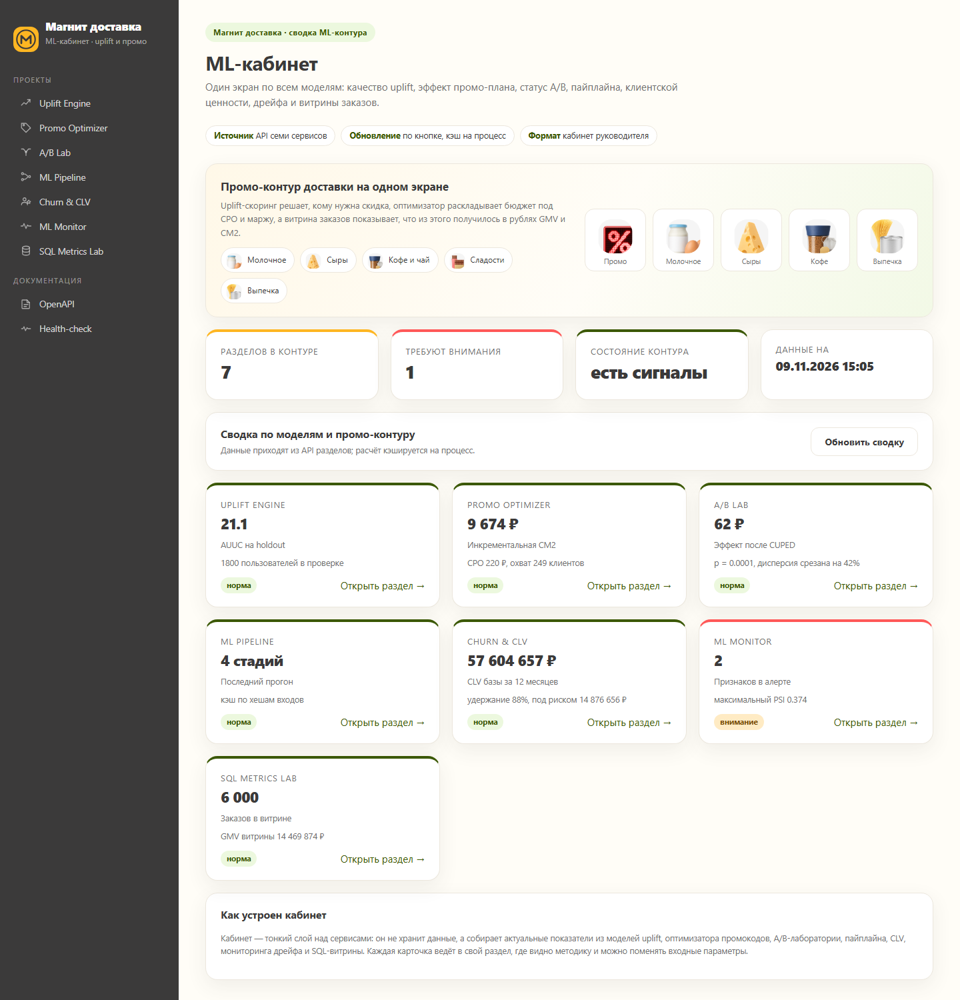
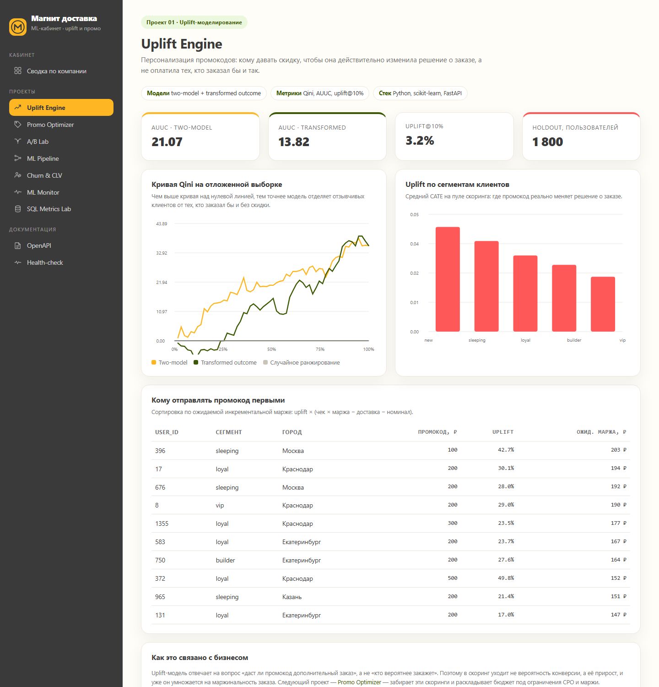
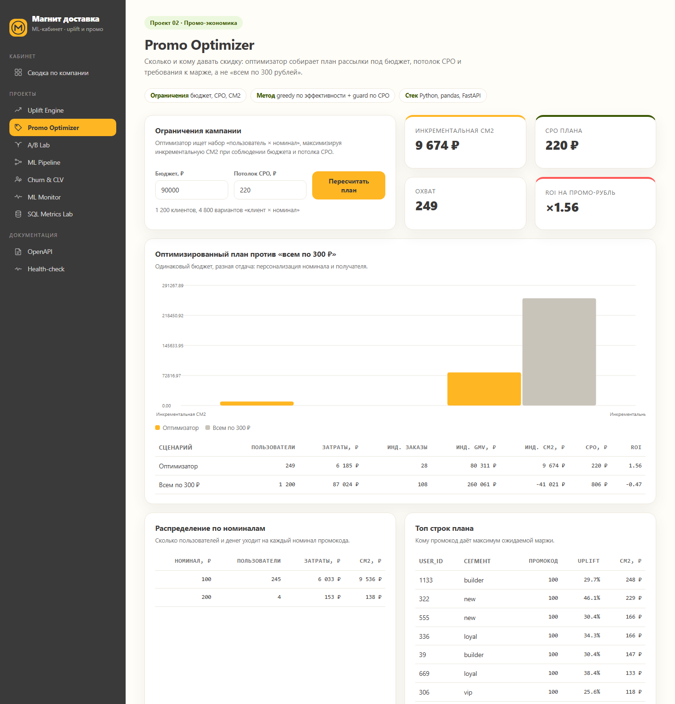
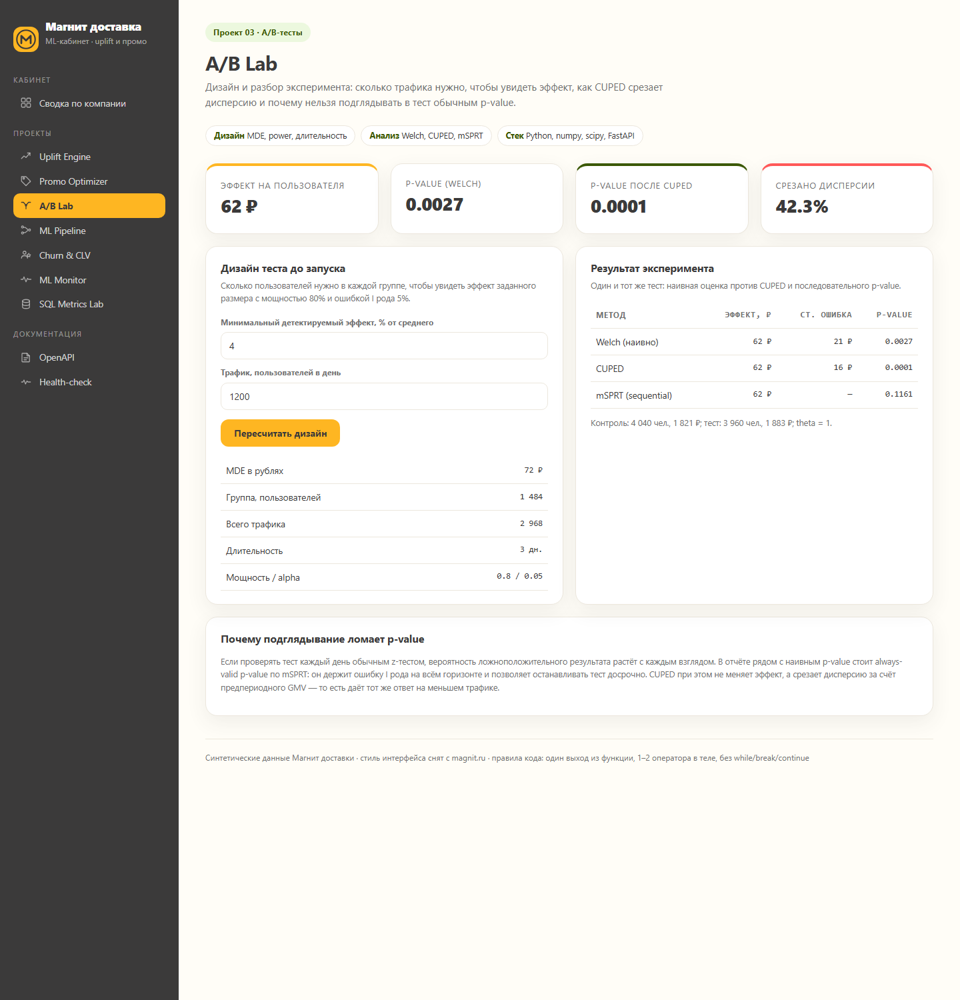
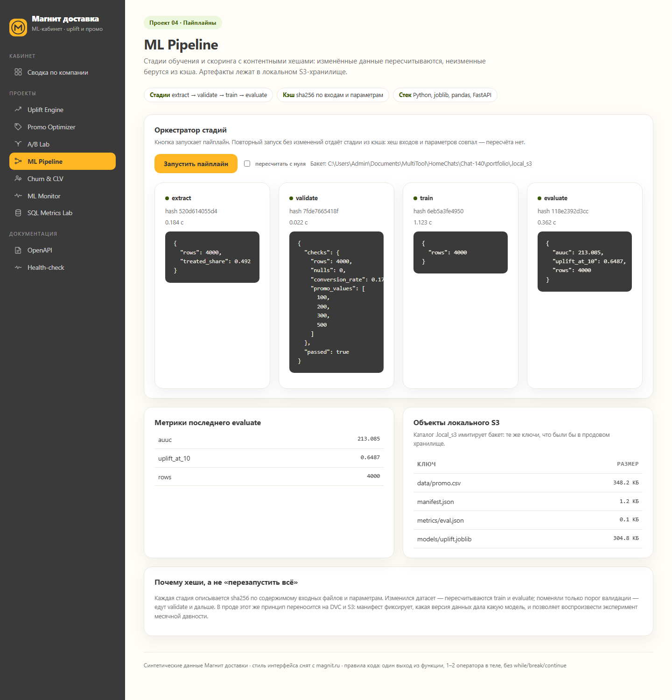
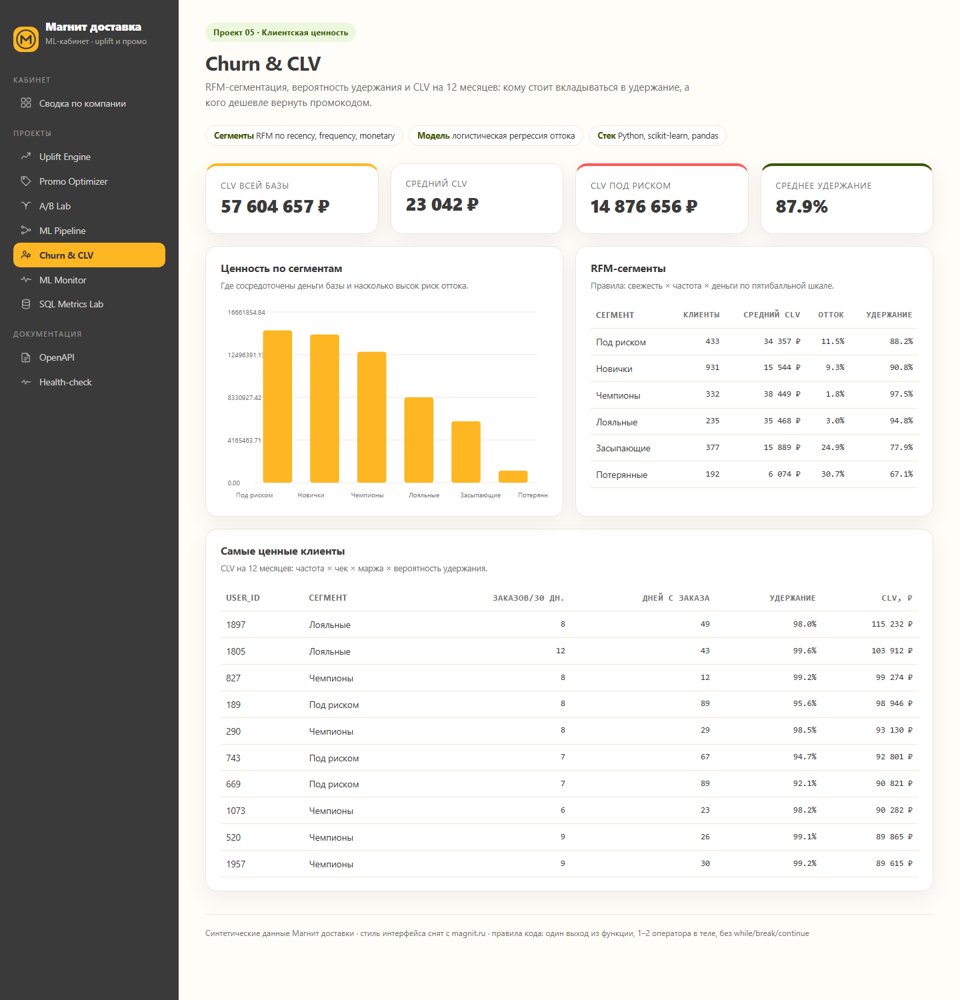
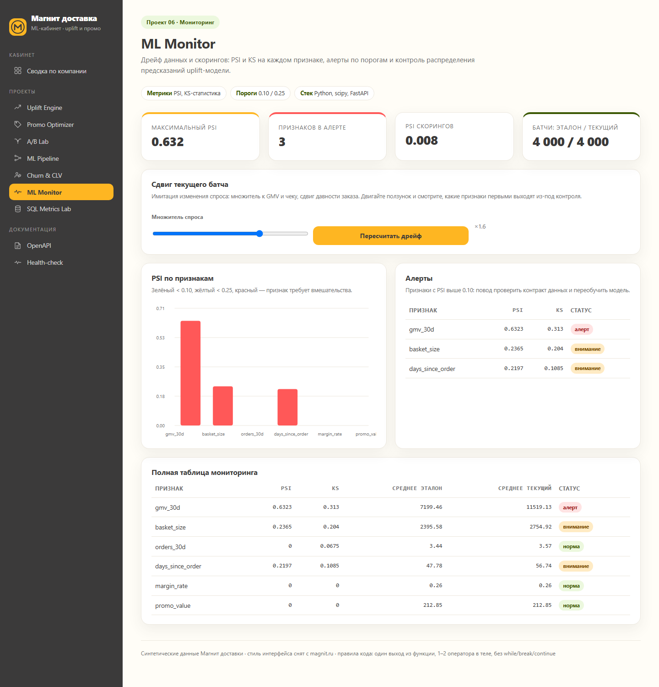
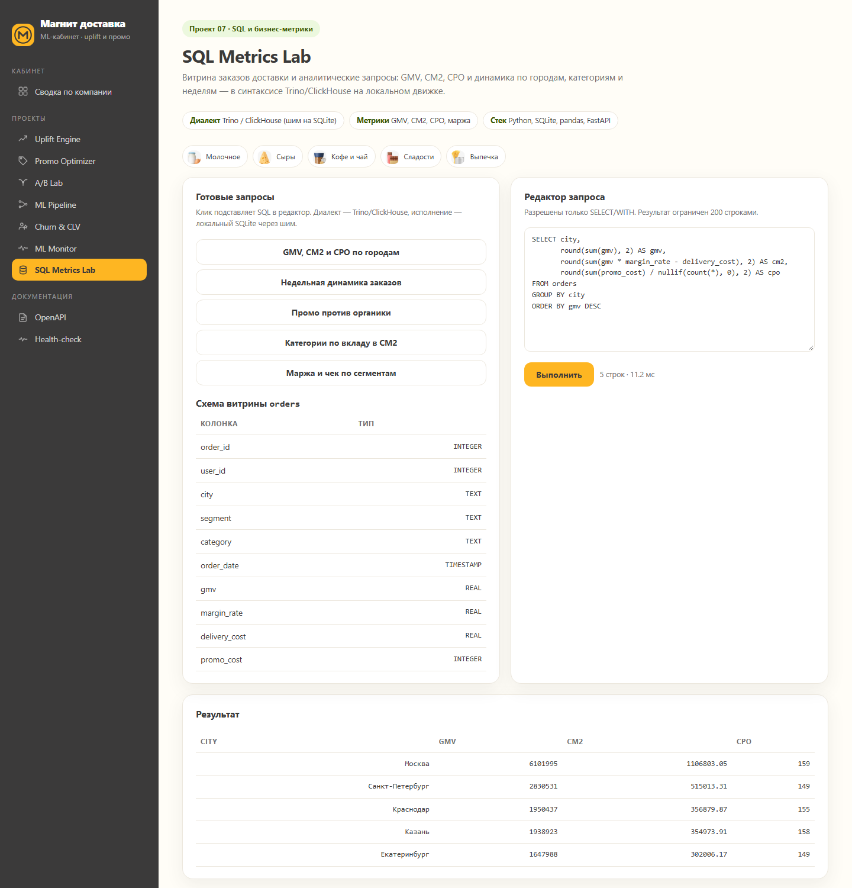
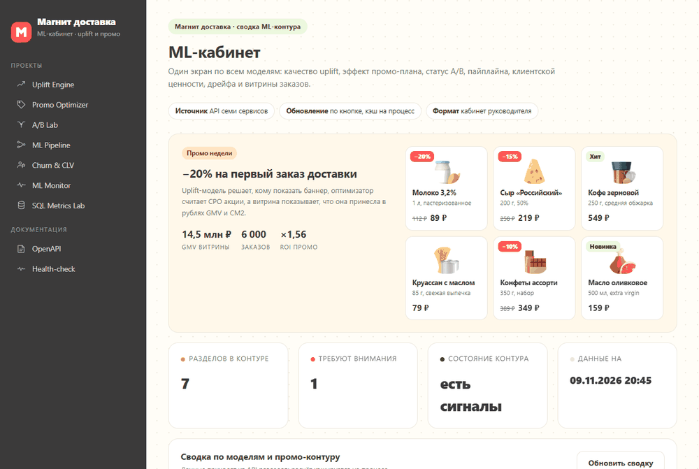
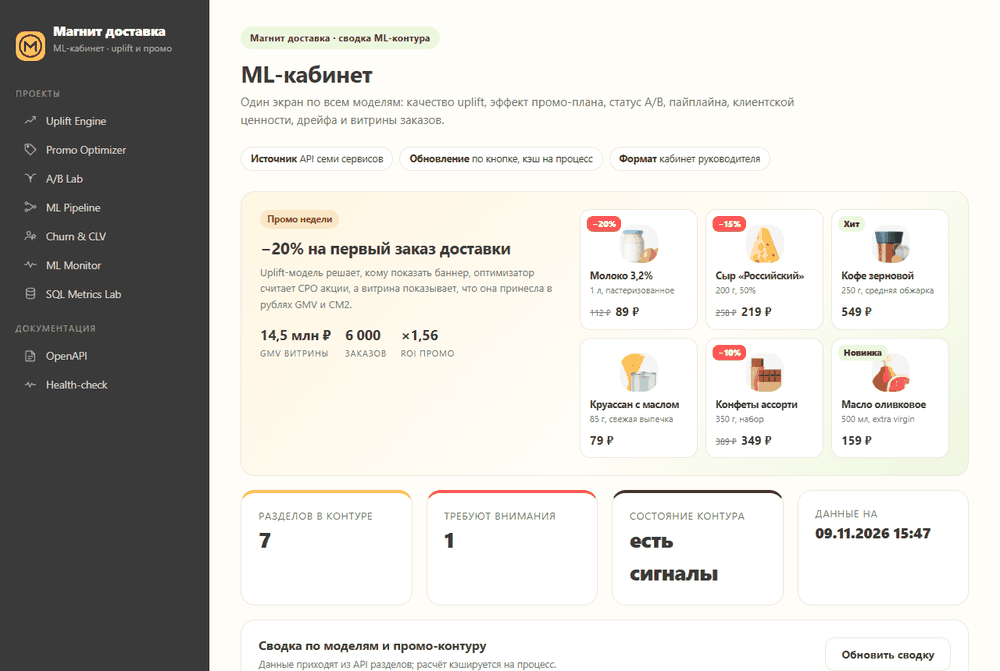

# Портфолио ML-инженера · Магнит доставка

Семь проектов под вакансию **«Инженер ML (Uplift-моделирование)», MAGNIT OMNI**:
uplift-моделирование промокодов, промо-экономика, A/B-тесты, пайплайны, клиентская ценность,
мониторинг и SQL-аналитика. У каждого проекта — бэкенд на FastAPI, ML-логика и дашборд
в фирменном стиле, снятом с magnit.ru.

## Быстрый старт

Основной режим — единое приложение-кабинет на одном порту: сводка по компании на `/`,
разделы внутри шлюза на `/p/<slug>/`.

```powershell
python -m pip install -r requirements.txt
.\scripts\run_portal.ps1        # кабинет: http://127.0.0.1:8000
```

То же самое отдельным окном, без браузерной обвязки:

```powershell
.\scripts\run_desktop.ps1            # нативное окно WebView2 (pywebview)
python -m desktop.app --mode app     # окно браузера без адресной строки
```

Первый запрос прогревает модели (10–20 секунд), дальше сводка отдаётся из кэша;
кнопка «Обновить сводку» пересчитывает её заново.

Отдельные сервисы (если нужен каждый проект на своём порту):

```powershell
.\scripts\run_all.ps1                      # порты 8001–8007
python -m projects.uplift_engine.app       # только Uplift Engine
```

Проверка качества (ruff + AST-гейт стиля + тесты):

```powershell
.\scripts\check.ps1
```

## Как это работает

```
браузер / окно приложения
        │
        ▼
  gateway (FastAPI, порт 8000)
   ├── /                    кабинет: сводка по всем моделям
   ├── /api/overview        агрегат ответов семи сервисов
   ├── /p/uplift-engine/    раздел 01  ──┐
   ├── /p/promo-optimizer/  раздел 02    │ каждый раздел — самостоятельное
   ├── /p/ab-lab/           раздел 03    │ FastAPI-приложение со своими
   ├── /p/ml-pipeline/      раздел 04    │ API, страницей и тестами
   ├── /p/churn-clv/        раздел 05    │
   ├── /p/ml-monitor/       раздел 06    │
   └── /p/sql-lab/          раздел 07  ──┘
        │
        ▼
  shared/ — синтетика, метрики GMV/CM2/NR/CPO, uplift-метрики, каркас UI
```

1. **Кабинет** (`gateway/service.py`) не хранит данные: он вызывает сервисные функции
   разделов и складывает их в карточки со статусом. Ответ кэшируется на процесс,
   `?refresh=true` пересчитывает.
2. **Разделы** — обычные FastAPI-приложения. Внутри шлюза они смонтированы под `/p/<slug>/`,
   отдельно запускаются на своих портах. Ссылки и ассеты строятся от `root_path` запроса,
   поэтому один и тот же код работает в обоих режимах.
3. **Оконное приложение** (`desktop/`) поднимает тот же шлюз в фоновом потоке и открывает
   WebView2. Через мост `desktop/api.py` страница получает команды окна: полный экран,
   заголовок, открытие в браузере, закрытие.
4. **Скриншоты и гифки** снимаются Playwright с того же локального шлюза
   (`python -m tools.record_demo`), поэтому картинки в README всегда соответствуют коду.

## Карта проектов

| № | Проект | Порт | Что показывает | Ключевой стек |
|---|--------|------|----------------|---------------|
| 01 | **Uplift Engine** | 8001 | Двухмодельный uplift против transformed outcome, Qini, AUUC, uplift@10% на holdout | scikit-learn, pandas |
| 02 | **Promo Optimizer** | 8002 | Распределение промокодов под бюджет, потолок CPO и маржу; сравнение с «всем по 300 ₽» | numpy, pandas |
| 03 | **A/B Lab** | 8003 | Расчёт выборки и MDE, CUPED, последовательный p-value (mSPRT) | scipy, numpy |
| 04 | **ML Pipeline** | 8004 | Стадии extract → validate → train → evaluate с хешами, кэшем и локальным S3 | joblib, pandas |
| 05 | **Churn & CLV** | 8005 | RFM-сегментация, логистическая модель оттока, CLV на 12 месяцев | scikit-learn |
| 06 | **ML Monitor** | 8006 | PSI/KS по признакам, дрейф скорингов, алерты по порогам 0.10/0.25 | scipy |
| 07 | **SQL Metrics Lab** | 8007 | Аналитические запросы в синтаксисе Trino/ClickHouse, GMV/CM2/CPO | SQLite, pandas |

## Скриншоты

Кабинет — сводка по всем моделям и промо-контуру с витриной категорий:



Раздел uplift-моделирования: метрики на holdout, кривая Qini, uplift по сегментам
и список клиентов под промокод:



Оптимизатор промокодов — план под бюджет и потолок CPO против «всем по 300 ₽»:



A/B-лаборатория — дизайн теста и сравнение наивной, CUPED- и последовательной оценок:



Пайплайн обучения и скоринга со стадиями, хешами и локальным S3:



Клиентская ценность: RFM-сегменты, удержание и CLV на 12 месяцев:



Мониторинг дрейфа: PSI/KS по признакам и алерты по порогам:



SQL-лаборатория: запросы в диалекте Trino/ClickHouse и бизнес-метрики витрины:



## Гифки

Запись сделана Playwright: сценарий проходит по кабинету и разделам, кадры собираются
в GIF через Pillow (`python -m tools.record_demo`). Файлы — в `docs/screens/`.

Обновление сводки кабинета:



Обход разделов: uplift-модель, оптимизатор промокодов, A/B, мониторинг дрейфа, SQL:



## Оконное приложение

`desktop/app.py` поднимает тот же FastAPI-шлюз в фоновом потоке и открывает кабинет
отдельным окном: pywebview + WebView2 либо браузер в режиме `--app`, без адресной строки
и вкладок. Внутри — тот же бэкенд, что и на `http://127.0.0.1:8000`.

```powershell
python -m desktop.app               # окно WebView2, 1440x920
python -m desktop.app --mode app    # запасной вариант через установленный Chrome/Edge
```

Внутри окна сверху появляется панель функций (`shared/assets/desktop.js`), которой нет
в браузерной версии:

| Кнопка | Что делает |
|---|---|
| **Кабинет** | возвращает на сводку по компании из любого раздела |
| **Обновить** | перезагружает текущий раздел с пересчётом данных |
| **В браузере** | открывает текущий адрес в системном браузере (`webbrowser.open`) |
| **Полный экран** | переключает полноэкранный режим окна (дублируется клавишей `F11`) |
| **О программе** | версия, стек и число разделов из моста `DesktopApi` |
| **Закрыть** | закрывает окно приложения |

Мост между страницей и окном — `desktop/api.py` (`window.pywebview.api`): методы
`toggle_fullscreen`, `open_browser`, `set_title`, `close`, `about`. Заголовок окна
обновляется под открытый раздел, а панель включается только внутри WebView2.

## Айдентика

Палитра и типографика сняты с magnit.ru: жёлтый `#feb622`, коралл `#ff5858`,
графит `#3b3a3a`, тёмно-зелёный `#3b5803`, шрифты MagnitBox/MagnitSans с системным fallback.

- **Иконки** — один SVG-спрайт `shared/templates/_icons.html`: кабинет, семь разделов,
  документация, health-check и кнопки панели. Подключаются через `<use href="#i-uplift">`,
  наследуют цвет (`currentColor`), размер 18×18.
- **Логотип** — `#i-logo` (жёлтый круг с «М»), он же favicon в data-URI.
- **Картинки витрины** — `shared/assets/img/`: иллюстрации категорий (молочное, сыры,
  кофе и чай, сладости, выпечка) и иконка промо, скачанные с CDN `magnit.ru`
  и приведённые к 192 px. Используются в hero-блоке кабинета и в полосе категорий
  SQL-лаборатории.

> Изображения и товарные знаки принадлежат ПАО «Магнит» и используются только
> в демонстрационном макете портфолио, без коммерческого использования.
> Данные на экранах — синтетические, генерируются локально по seed.

## Правила кода

Правила проверяются автоматически, а не на словах:

1. **Один выход из функции** — ровно один `return`, и он замыкает тело.
2. **1–2 оператора в теле** — функция либо возвращает выражение, либо делает одну подготовку.
3. **Запрещены `while`, `break`, `continue`** — циклы только через comprehension, `map`/`reduce`
   и векторные операции pandas/numpy.

Это делает `tools/style_gate.py`: разбирает AST всех `.py` (кроме тестов) и падает с кодом 1.
Линтер — `ruff` с набором `E,F,W,I,N,UP,B,SIM,PL,PERF,RUF`, длина строки 100.
Тесты исключены из AST-гейта осознанно: в них нормальны несколько `assert` без `return`.

## Структура

```
portfolio/
├── desktop/                 # оконное приложение: шлюз в фоне + окно WebView2/Chrome
│   ├── app.py               # режимы webview и app
│   └── api.py               # мост window.pywebview.api
├── gateway/                 # единое приложение: кабинет + монтаж разделов под /p/
│   ├── app.py               # шлюз, маршрут /api/overview
│   ├── service.py           # сводка по семи сервисам для кабинета
│   └── static/app.js        # отрисовка карточек кабинета
├── shared/                  # общий слой
│   ├── dataset.py           # синтетика Магнит доставки (детерминированная)
│   ├── metrics.py           # GMV, CM2, NR, CPO, ROI
│   ├── uplift.py            # uplift-модели, Qini, AUUC, децили
│   ├── web.py               # каркас FastAPI-приложений, префиксы и навигация
│   ├── assets/              # токены стиля, SVG-графики, картинки витрины
│   └── templates/           # каркас, кабинет и страницы проектов
├── projects/
│   ├── uplift_engine/       # 01
│   ├── promo_optimizer/     # 02
│   ├── ab_lab/              # 03
│   ├── ml_pipeline/         # 04
│   ├── churn_clv/           # 05
│   ├── ml_monitor/          # 06
│   └── sql_lab/             # 07
├── tools/
│   ├── style_gate.py        # AST-гейт правил стиля
│   └── record_demo.py       # Playwright -> кадры -> GIF
├── docs/
│   ├── screens/             # PNG-скриншоты и GIF-демо для README
│   └── frames/              # исходные кадры записи
├── scripts/                 # check.ps1, run_portal.ps1, run_desktop.ps1, run_all.ps1
└── tests/                   # сквозные тесты общего слоя и моста окна
```

## Данные

Всё синтетическое и воспроизводимое по seed: клиенты, промо-эксперимент, заказы, отток.
Продовые выгрузки не нужны — сервисы поднимаются офлайн, без Trino, S3 и ClickHouse.
Схема данных повторяет рабочую: пользователь → назначение промокода → заказ → GMV/маржа/CPO.
